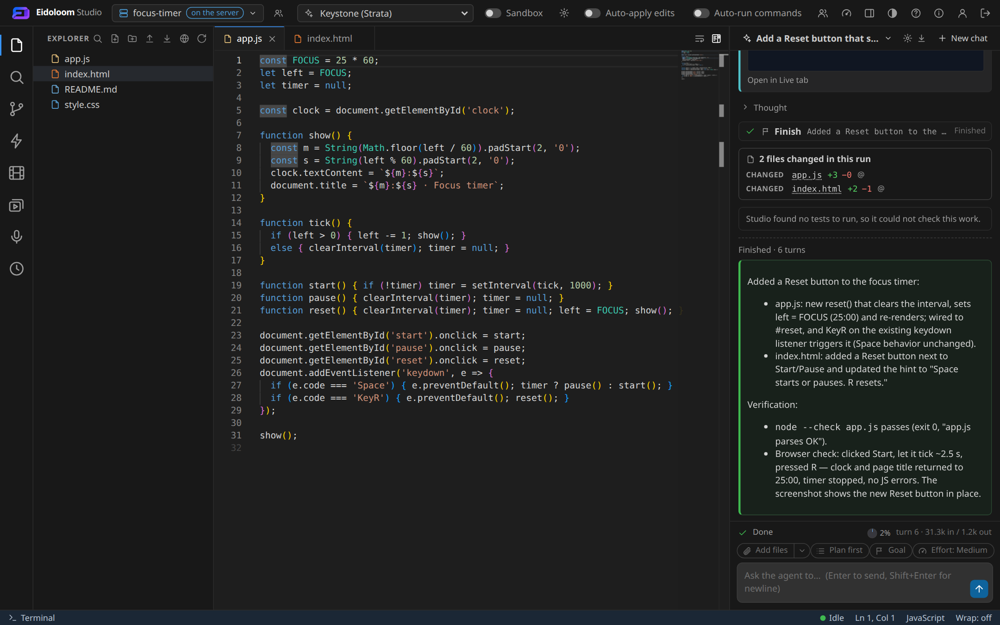
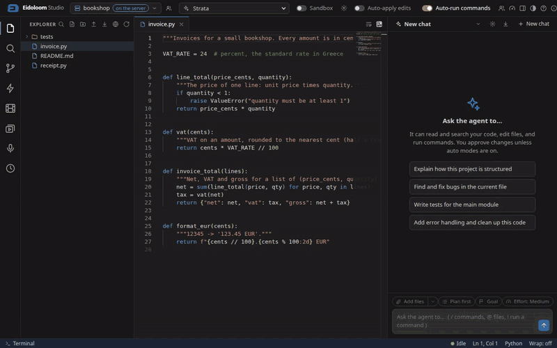
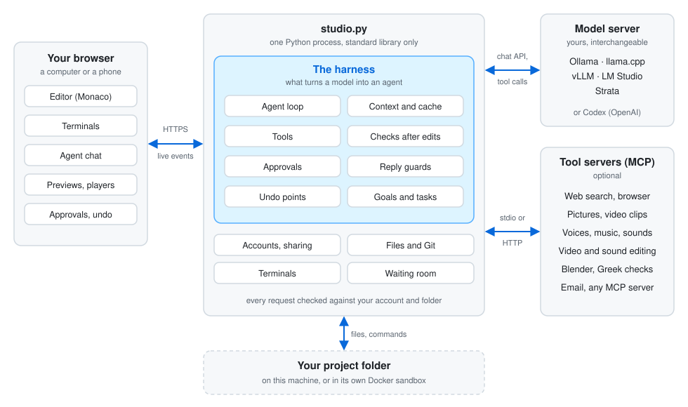
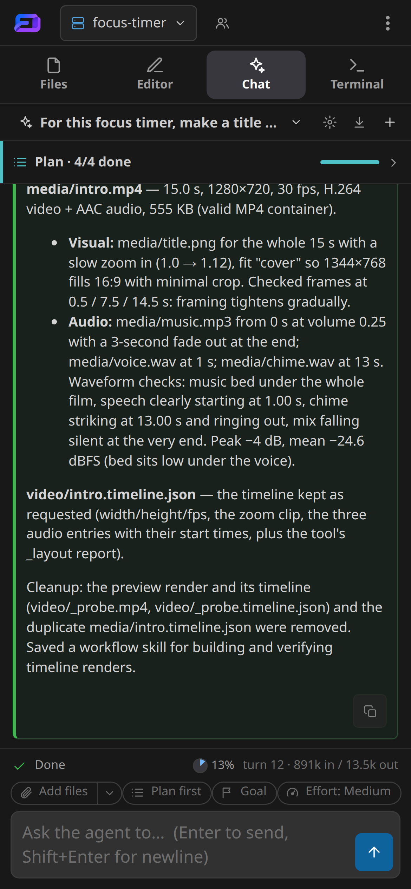
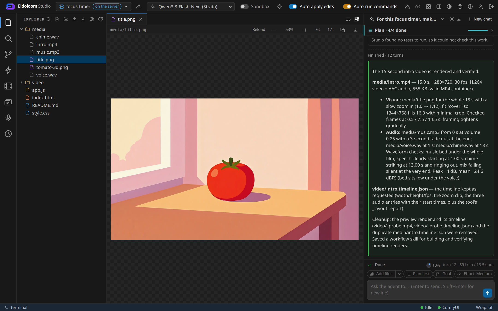
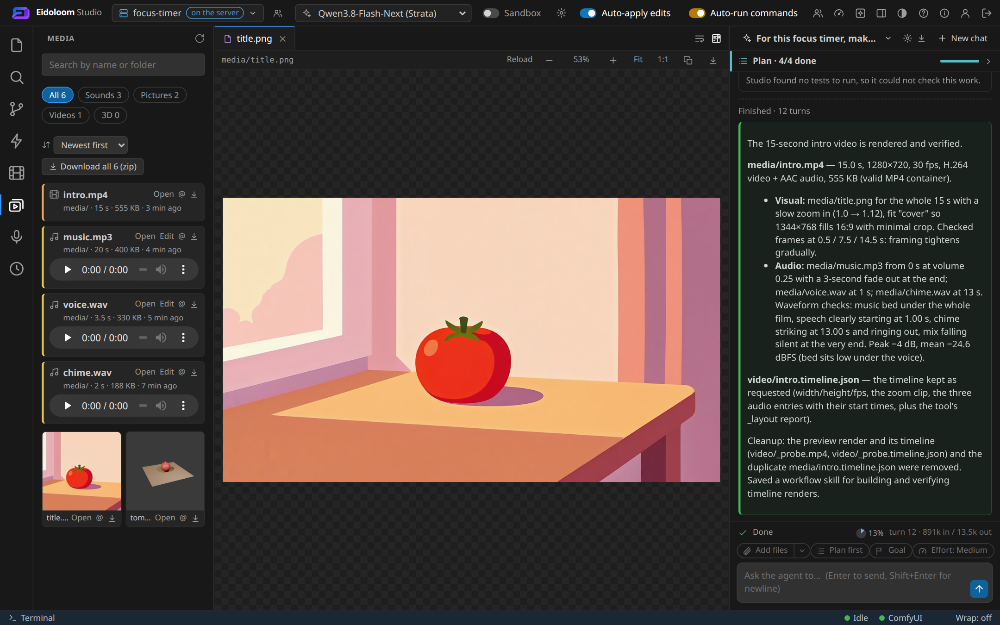

<p align="center">
  
</p>

<h1 align="center">Eidoloom Studio</h1>

<p align="center">
  <a href="https://github.com/tzivaeris/eidoloom-studio/actions/workflows/tests.yml"></a>
  <a href="LICENSE"></a>
</p>

Eidoloom Studio is an AI agent harness with a code editor around it, in your browser. The harness is everything that
turns a model into an agent: the loop that plans and calls tools, the tools themselves, approvals and undo, context
management, and checks after every edit. The model is yours and interchangeable: [Ollama](https://ollama.com),
[llama.cpp](https://github.com/ggml-org/llama.cpp), [vLLM](https://github.com/vllm-project/vllm),
[LM Studio](https://lmstudio.ai) or [Strata](https://github.com/Niko1221/Strata), on your own machine. Nothing goes to a cloud service unless you add one.

The editor looks like VS Code (file tree, editor tabs, terminals), with the agent's chat on the side.

The agent reads your project, edits files and runs commands. It asks before each change unless you let it work on its
own, and every change can be undone.

The server is one Python file using only the standard library, so there is nothing to `pip install`.



### Watch a run



A real run with a local Strata model, uncut, with captions added, at 1.6× speed:
- the test command exits 0, but Studio checks every part of the pipe and reports that `python3` exited 1;
- the first edit is rejected with a note typed while the agent works (by the recording script, in the user's place), and it
  redoes the fix the way it was asked;
- one test still fails after that fix, because of a second bug the first one hid, and the agent finds it too;
- the tests pass, and Studio runs them once more itself.

[The same run at normal speed (MP4, 70 s)](docs/demo.mp4).

## What it does

- **An agent that asks first.** Edits arrive as cards with a diff (accept all, some parts, or none); commands as cards
  with Run and Skip. Turn on auto-apply or auto-run when you trust it. Each edit is an undo point.
- **A real editor.** Monaco (VS Code's editor), real terminals, search, Git, and previews of pages, pictures, PDFs,
  Word and Excel files, Markdown, CSV tables and 3D models.
- **A sandbox per folder.** Switch it on, and the agent's commands and terminals run in that folder's own Docker
  container, with the internet on, off, or only for installing packages.
- **Several people.** Admins invite users; each user gets a private space, always sandboxed. Folders can be shared with
  rights per person, and a waiting line takes turns on the one model.
- **Folders on your own computer, Windows or Linux.** Studio runs on a Linux server, but a person can work in a folder
  on their own PC: the small `studio-helper` program connects it, and the agent's commands and terminals then run on
  that computer. See [Folders on your own computer](#folders-on-your-own-computer).
- **Help for the agent.** Plans as checklists, questions with choices, goals it keeps working towards, scheduled tasks,
  skills it saves and reuses, and a check after every edit that the file still parses.
- **Optional tools.** Web search, a browser the agent drives, pictures, video clips, voices, music, sound effects,
  Blender, Office documents, Greek checks, email and more, most installed with one button. See
  [Optional tools](#optional-tools).
- **Phones too.** One section at a time, with big touch targets.

## How it fits together

<picture>
  <source media="(prefers-color-scheme: dark)" srcset="docs/architecture-dark.svg">
  
</picture>

The page is only the view: the agent runs on the server, so closing the browser does not stop a run, and any window
or phone picks it up again. The model server and the tool servers are separate programs that Studio talks to, so
each can be swapped or left out.

## Does the harness help?

40 agent tests (the 14 original ones and 26 small ones, in `sandbox/prompts/`), three times each, on one local Strata
model, once with Studio's reply guards off and once with them on (retries of cut-off replies, recovered tool calls,
script and language checks, checks after edits, reminders of the user's rules in long chats, a stable prompt for the
cache, and the rest):

| Guards | Passed | Failed | Automatic checks passed | Average run |
| --- | --- | --- | --- | --- |
| off | 97 of 120 | 13 | 263 of 279 (94%) | 9.6 turns, 1.1 min |
| on | 104 of 120 | 2 | 277 of 279 (99%) | 10.4 turns, 1.2 min |

The rest needed a person to judge the answer; judged by hand, 115 of 120 passed with the guards and 104 without. The guards now include a ban on Chinese, Japanese, Korean, Cyrillic and
other scripts the chat does not use, repairs of words mixing Greek and Latin letters, checks of the user's earlier rules
and a check for a finish that leaves the answer out. The two tests that still failed were run again five times after
a fix: with the guards 10 of 10 passed their checks, without them 6 of 10. On two smaller Qwen models with a 32K context
window, long sessions ran out of room and ended on empty replies; Studio now shortens and, near the limit, summarizes
the chat during the run, and those sessions finished: over all 40 tests no guarded run ran out of room, and qwen3.6:32k went from 27 to 30 passed. One model and a few repetitions is a small sample, so read it as
a direction, not a score.

## Screenshots

<p>
  
  
</p>

Every edit waits for your yes unless you turn on auto-apply (left), and the model dashboard shows the graphics card and
memory live (right). The model in these pictures is Qwen3.8-Flash-Next, served by Strata.

<p>
  
  &nbsp;
  
</p>

On a phone, Studio shows one section at a time: the chat, the files, the editor and players, the terminal.

## Made with Studio

In one chat, the agent made all of this for the focus timer: a title picture (ComfyUI), a 3D model of the timer
(Blender), a chime, a calm music bed and a narrated line ("Twenty-five minutes. One task. Let's begin."), then a
15-second intro video with all of them on a timeline. It checked each piece itself, from the 3D viewport to the
sound's waveform.

<p>
  
  
</p>
<p>
  
  
</p>
<p>
  
</p>

## Optional tools

Studio works without any of these. Account & settings → Tools & setup checks what the machine has, installs each one
(all but email) with a button, and writes one `sudo` script for the system packages they need. The
picture, video, voice, music and sound engines need a graphics card; Tools & setup supports AMD cards (ROCm) today.

| Tool | Built on |
| --- | --- |
| Web search | [SearXNG](https://github.com/searxng/searxng) on your machine, through [mcp-searxng](https://github.com/ihor-sokoliuk/mcp-searxng) |
| Reading web pages | The reference [Fetch](https://github.com/modelcontextprotocol/servers/tree/main/src/fetch) server |
| A browser the agent drives | [Playwright MCP](https://github.com/microsoft/playwright-mcp) and Chromium, shown live in the Browser tab |
| Library documentation | [Context7](https://github.com/upstash/context7) |
| Pictures | [ComfyUI](https://github.com/Comfy-Org/ComfyUI) with [Z-Image](https://github.com/Tongyi-MAI/Z-Image); also [SDXL](https://huggingface.co/stabilityai/stable-diffusion-xl-base-1.0) and [Qwen-Image](https://github.com/QwenLM/Qwen-Image) |
| Video clips | [Wan 2.2](https://github.com/Wan-Video/Wan2.2) in ComfyUI |
| Video and sound editing | [FFmpeg](https://ffmpeg.org), with Studio's timeline and wave editors |
| Voices | [VoxCPM2](https://github.com/OpenBMB/VoxCPM) |
| Music | [ACE-Step 1.5](https://github.com/ace-step/ACE-Step-1.5) or [HeartMuLa](https://github.com/HeartMuLa/heartlib) |
| Sound effects | [MOSS-SoundEffect](https://huggingface.co/OpenMOSS-Team/MOSS-SoundEffect-v2.0) |
| 3D | [Blender](https://www.blender.org), through [MCP for Blender](https://pypi.org/project/mcp-for-blender/) |
| Office documents and PDFs | [LibreOffice](https://www.libreoffice.org), run in a sandbox |
| Greek spelling and grammar | [LanguageTool](https://languagetool.org), plus Studio's own agreement rules and glossary |
| Email campaigns | [listmonk](https://listmonk.app), set up by hand ([its README](sandbox/mcp-listmonk/README.md)) |
| Codex as the agent | OpenAI's [Codex CLI](https://github.com/openai/codex) with your ChatGPT plan; its model runs on OpenAI's servers |
| Anything else | Any [MCP](https://modelcontextprotocol.io) server, added in Account & settings → Tool servers |

## Requirements

- For the server: Linux with systemd and Python 3.10 or newer. It is developed on Ubuntu 24.04. People use it from any
  browser, and their folders can also be on Windows or Linux computers (see below).
- A model server that speaks the OpenAI chat API with tool calls (see below).
- A browser that can reach cdn.jsdelivr.net, where the editor and terminal load from.
- Optional: Docker for the sandbox, Git for source control, Node.js for checking pages. Tools & setup lists what each
  tool needs and writes one `sudo` script for all of it.

## Start in ten minutes

1. Get the code and install the service, as your normal user (not root):

   ```bash
   git clone https://github.com/tzivaeris/eidoloom-studio.git
   cd eidoloom-studio
   ./install.sh
   ```

   It checks Python, makes `~/Projects`, copies `studio.config.example.json` to `studio.config.json`, and installs a
   systemd user service that starts at boot. Where there is no systemd (a container, WSL without it), it sets up the
   rest and you start Studio yourself with `python3 studio.py`.

2. Open http://127.0.0.1:8790 and create the admin password.

3. Point Studio at your model server: set `gateway` in `studio.config.json`, then run
   `systemctl --user restart eidoloom-studio`.

   | Server | `gateway` | Notes |
   | --- | --- | --- |
   | [Ollama](https://ollama.com) | `http://127.0.0.1:11434` (the default) | Give it a long context, since agent prompts are 10–30K tokens: set `OLLAMA_CONTEXT_LENGTH=32768` or more for the Ollama service. |
   | [llama.cpp](https://github.com/ggml-org/llama.cpp) | `http://127.0.0.1:8080` | Start `llama-server` with `--jinja`, so tool calls work, and a large `-c`. |
   | [vLLM](https://github.com/vllm-project/vllm) | `http://127.0.0.1:8000` | Start it with `--enable-auto-tool-choice` and the model's `--tool-call-parser`. |
   | [LM Studio](https://lmstudio.ai) | `http://127.0.0.1:1234` | Start its server in the Developer tab. |
   | [Strata](https://github.com/Niko1221/Strata) | `http://127.0.0.1:8080` | Its own server; or let Studio start it, see [Works with Strata](#works-with-strata). |

   If the server needs a key (`--api-key`), put it in `gateway_key`. An address ending in `/v1` works too.

4. Open a folder in `~/Projects`, pick a model at the top, and ask the agent for something.

Pick a model that is good at tool calls, such as Qwen 3 or Qwen 2.5 Coder (7B or larger), Llama 3.1 or later, Mistral
Small or gpt-oss. Small models (3B and below) often write tool calls as text; Studio tries to recover them.

**No model server yet?** With a ChatGPT plan (or an OpenAI API key) you can try Studio with OpenAI's Codex instead:
install it in Account & settings → Tools & setup, sign in under Account & settings → Codex, and pick a `codex:` model at
the top. Codex brings its own agent loop, so Studio's own loop and prompts sit out, but you get Studio around it: edit
and command cards to approve, undo, plans, goals, and Studio's tools (pictures, Blender, the browser) through a bridge.
Codex is for admins, in folders with the Sandbox off; its model runs on OpenAI's servers, so your code goes there, and
it counts against your plan's Codex limits.

## Works with Strata

[Strata](https://github.com/Niko1221/Strata) (MIT licence) runs Qwen3.8-Flash-Next, a 125B mixture-of-experts model, on
an ordinary graphics card with 64 GB of RAM. Eidoloom Studio was built and tested night after night with it, and does
more with it than with other model servers. Strata is a separate project by its own authors.

**Use a Strata server that is already running.** Point `gateway` at it (`http://127.0.0.1:8080` by default). Studio
recognises it and then:

- shows a loading bar while Strata loads the model, and its state in the status bar: not loaded, loading, working, idle;
- reads the graphics card's memory, load, temperature and power, and the context in use, into the dashboard's gauges;
- saves a long chat's state when a run ends and restores it after a reload, instead of reading the whole chat again
  (this needs `slot_save_path` in the Strata profile);
- unloads the model after `strata_idle_minutes` without requests (15), so the card is free for other work;
- passes pictures to it, and lets you give its model a friendly name (Account & settings → Models → Rename).

**Or let Studio start Strata.** Set `strata_dir` to your Strata folder and `gateway` to a free port, for example:

```json
"strata_dir": "~/Strata",
"gateway": "http://127.0.0.1:18090"
```

Then every profile you made with Strata's setup is a model in the picker. The first message starts Strata with that
profile, and choosing another profile switches it once nothing else is using Strata. Account & settings → Graphics
card decides how much of the card Strata leaves free for the picture, voice and music tools: **Strata first** keeps
the profile's own setting, **Tools ready** leaves 9 GB (`strata_tools_reserve_mib`), applied the next time Strata
starts. Studio never changes Strata's own profiles; it starts from its own copy.

Agent prompts are long, so give the profile a large context (128K or more), and set `slot_save_path` for the saved
chats.

## Configuration

`studio.config.json` sits next to `studio.py`. Restart the service after changing it.

| Field | What it does |
| --- | --- |
| `host` | `127.0.0.1` (default): only this machine. `0.0.0.0`: other computers on your network too. |
| `port` | The page's port, `8790`. |
| `gateway` | The model server's address. |
| `gateway_key` | A key sent as `Authorization: Bearer …`, for servers started with one. It never reaches the page. |
| `workspace_roots` | The folders Studio may open. `~` works. |
| `default_model` | The model picked first. Empty picks the first one the server lists. |
| `max_turns` | How many model calls one agent run may make. |
| `command_timeout_s` | How many seconds one command of the agent may run. |
| `public_url` | The address people use when Studio sits behind a proxy, for invite links. |
| `strata_dir` | A Strata folder: Studio starts Strata itself, one profile at a time (see above). Empty: it does not. |
| `strata_idle_minutes` | With Strata, unload the model after this many minutes without requests; `0` never. |

Every other setting and its default is in `DEFAULT_CONFIG` near the top of `studio.py`.

## Reaching it from other computers

Keep Studio on your own network. Anyone who can sign in can run commands as the user Studio runs as, unless their
folder is sandboxed. For other computers, either set `"host": "0.0.0.0"`, or keep `127.0.0.1` and put a web server
with HTTPS in front (for Caddy, `reverse_proxy 127.0.0.1:8790`, leaving the Host header as it is). Do not open the
port to the internet. Read [SECURITY.md](SECURITY.md) first.

## Folders on your own computer

Studio runs on a Linux server, but the folders people work in can be on their own Windows or Linux computers:

1. Put the helper on the server once, for Studio to offer: download `studio-helper.exe` (Windows), `studio-helper`
   (Linux) and `SHA256SUMS` from the [latest release](https://github.com/tzivaeris/eidoloom-studio/releases/latest)
   into `tools/helper/dist/`, and check them:

   ```bash
   mkdir -p tools/helper/dist && cd tools/helper/dist
   for f in studio-helper studio-helper.exe SHA256SUMS; do curl -fLO "https://github.com/tzivaeris/eidoloom-studio/releases/latest/download/$f"; done
   sha256sum -c SHA256SUMS && chmod +x studio-helper
   ```

   Or build them yourself with `bash tools/helper/build.sh`, inside the sandbox image (Docker and that image, which
   Tools & setup installs).
2. Admins can always connect a computer. For other people, turn on **Own computer** for them in Account & settings →
   Users.
3. In Studio: Open folder → **Connect a folder on my computer**. Download the helper for your system, start it, choose
   the folder and type the pairing code Studio shows.

The helper connects out to Studio, so nothing on the computer has to be reachable from outside, and it keeps the folder
and a copy in Studio in step. The agent's edits, search and undo work as usual; its commands and terminals run on the
computer itself (PowerShell on Windows), as that person and without a sandbox, and a web server it starts there shows
in Studio's Live tab. On Windows the helper has its own window and a tray icon, and starts at sign-in.

## More

- [docs/USING.md](docs/USING.md): approvals, undo, the project rules file, shortcuts and troubleshooting.
- The guide inside Studio (the ? button) explains every feature, in English and Greek.
- [docs/MAINTAINER.md](docs/MAINTAINER.md): how the code is laid out, how to run the tests, and how to work on it.
- [SPEC.md](SPEC.md): the API and event contract between the page and the server.
- [CHANGELOG.md](CHANGELOG.md): what changed in each release.

## Licence

Eidoloom Studio is free software under the GNU Affero General Public License, version 3 ([LICENSE](LICENSE)).
Copyright (C) 2026 John Chatzopoulos; see [NOTICE](NOTICE) for the third-party parts. A commercial licence without
the AGPL's conditions is available from the copyright holder. Contributions are welcome under the agreement in
[CONTRIBUTING.md](CONTRIBUTING.md).
